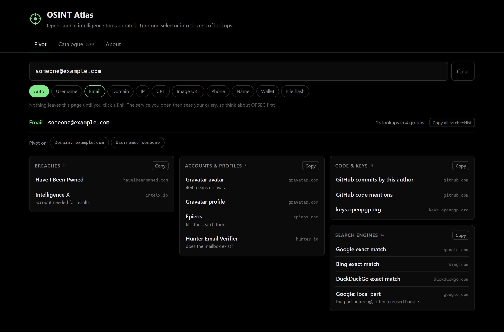
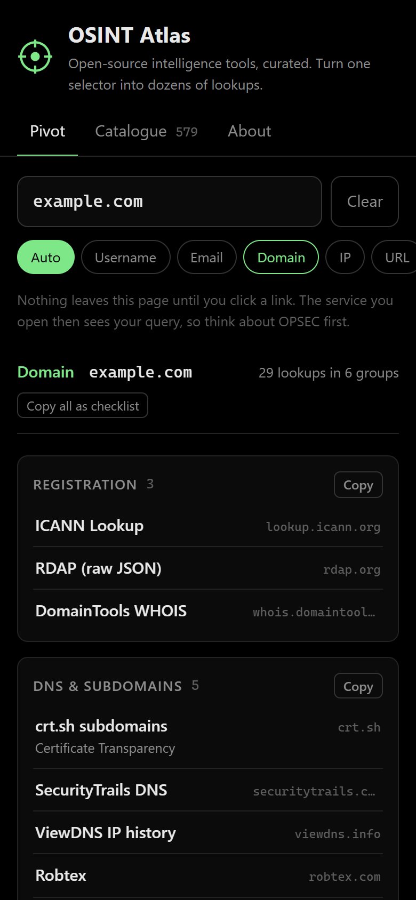
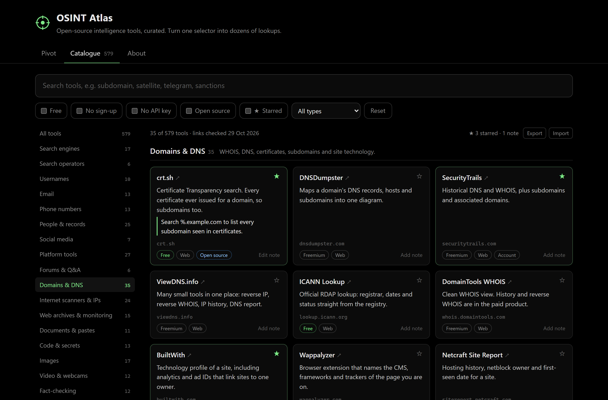

# OSINT Atlas

[](https://github.com/skriptkiddy98x/osint-atlas/actions/workflows/validate.yml)


**579 OSINT tools in 35 categories, searchable and filterable, plus a pivot board that turns one selector into dozens of ready-made lookups.** It is one static page with no backend, no tracking and no API keys.

**[Open OSINT Atlas](https://skriptkiddy98x.github.io/osint-atlas/)**



## Why

Big "awesome" lists such as [awesome-osint](https://github.com/jivoi/awesome-osint) are great for discovering tools and slow to use in the middle of an investigation. OSINT Atlas covers the same ground in a form you can work with:

| | Markdown awesome list | OSINT Atlas |
|---|---|---|
| Find a tool | Ctrl+F on one long page | Instant search over names, descriptions, tags and your own notes |
| Narrow it down | Read every entry | Filter by category, free, no sign-up, no API key, open source, tool type |
| Dead links | Found by readers, one at a time | Every URL tested monthly by a GitHub Action; unreachable tools are flagged in the UI |
| Your shortlist | Bookmarks elsewhere | Star tools and attach notes, kept in your browser, exportable as JSON |
| From selector to lookups | Copy, open site, paste, repeat | Paste once: the pivot board builds the lookup URLs for you |
| Share a view | Link to a heading | The URL keeps your filters, e.g. `#catalogue?cat=companies&free=1` |
| Data format | Prose in Markdown | `data/tools.json`, schema-checked in CI, easy to reuse |

- **Pivot**: paste a username, email, domain, IP, phone number, URL, image URL, crypto wallet, file hash or a name. The type is detected for you, the value is normalised (`00421 905/123-456` becomes `+421905123456`, `https://www.Example.com/x` becomes `example.com`), and you get the lookups an analyst would open next, grouped by purpose.
- **Catalogue**: 579 tools in 35 categories, from search operators and usernames to satellite imagery, sanctions, crypto, the dark web and OPSEC. Every one-line description was written for this project.

## Pivot board

| Selector | Example | What you get |
|---|---|---|
| Username | `torvalds` | WhatsMyName, 40 direct profile URLs (social, code, gaming), exact-match searches |
| Email | `someone@example.com` | Have I Been Pwned, Gravatar (SHA-256 hashed in the browser), Epieos, Hunter, GitHub commits by author, PGP keys |
| Domain | `example.com` | RDAP/WHOIS, Certificate Transparency subdomains, DNS history, tech stack, reputation, Wayback, Google dorks |
| IP | `1.1.1.1`, IPv6 | ASN and owner, Shodan, LeakIX, AbuseIPDB, GreyNoise, VirusTotal, Tor relay history, reverse IP |
| Phone | `+421 905 123 456` | Normalised to E.164, Epieos, Sync.ME, libphonenumber, WhatsApp/Telegram, search engines |
| URL / image URL | `https://…/photo.jpg` | Google Lens, Bing, Yandex, TinEye, archives, Safe Browsing, URLhaus |
| Name | `Jane Doe` | Exact-match and LinkedIn dorks, news, OpenSanctions, OpenCorporates officers, ICIJ Offshore Leaks, court and research records |
| Wallet | `bc1…`, `0x…`, `T…` | Chain-specific explorers (BTC, ETH, TRON), wallet attribution, Chainabuse reports |
| File hash | MD5 / SHA-1 / SHA-256 | VirusTotal, MalwareBazaar, Hybrid Analysis, OTX, ThreatFox |

Each result also suggests **related pivots**: an email offers its domain and the handle before the `@`, and a URL offers its host. **Copy all as checklist** puts every link into a Markdown checklist for your case notes.

<p align="center"></p>

## Catalogue



- **Search** matches names, descriptions, categories, regions, tags and your own notes. Press <kbd>/</kbd> to jump to the search box and <kbd>Esc</kbd> to clear it.
- **Filters**: Free, No sign-up, No API key, Open source, Starred, and tool type (web, CLI, extension, app, API, dataset, guide). Category counts update live.
- **Labels** on every card: pricing, type, open source, account needed, API key needed, and a region code when a tool mainly covers one country.
- **Stars and notes**: star the tools you rely on and add notes such as "search `%.example.com` for subdomains". They stay in `localStorage` and can be exported to and imported from a JSON file.
- **Link health**: [`scripts/check_links.py`](scripts/check_links.py) tests every URL. A monthly workflow commits the result to `data/link-status.json`, and tools that stopped responding get an *Unreachable* label. Sites that block scripts count as "blocked", not dead.
- **Shareable views**: filters live in the address bar (`#catalogue?cat=domain&free=1&type=cli`).

Coverage leans towards tools that are maintained and useful in Europe. Next to the usual global services it lists Slovak, Czech and other EU sources: ORSR, RPVS, FinStat, ARES, Hlídač státu, national web archives, Demagog, Copernicus, TED, EUIPO and the EU Transparency Register.

## Passive and private by design

- **No third-party requests.** The page loads only its own HTML, CSS, JS and JSON. A strict Content-Security-Policy (`default-src 'self'`) enforces it, so there are no fonts, analytics or favicons fetched from elsewhere.
- **Selectors stay in the tab.** They are never written to the URL, history, `localStorage` or cookies. Only catalogue filters go into the URL, and only your stars and notes go into `localStorage`.
- **No referrer.** Every outbound link uses `rel="noopener noreferrer"`, so the services you open cannot see where you came from.
- **No scraping, no keys.** The app only builds links. Nothing is sent anywhere until you click one, and then only to that service.
- **No `innerHTML`.** The DOM is built with `createElement`/`textContent`, so data files cannot inject markup.

Opening a lookup still tells that service what you searched for. For sensitive work, use a separate browser profile, a VPN or Tor, and research accounts.

## Run it locally

No build step and no dependencies. Any static file server works:

```bash
git clone https://github.com/skriptkiddy98x/osint-atlas.git
cd osint-atlas
python -m http.server 8000
```

Then open <http://localhost:8000>. Opening `index.html` straight from disk does not work because browsers block `fetch()` on `file://` URLs.

## Project layout

```text
index.html               page shell, CSP, three views (Pivot, Catalogue, About)
assets/style.css         black theme, responsive down to 320 px
assets/js/selectors.js   type detection, normalisation, URL template expansion (no DOM, unit-tested)
assets/js/pivot.js       pivot board UI
assets/js/catalogue.js   catalogue search, filters, stars, notes and URL state
assets/js/storage.js     localStorage, export and import of stars and notes
assets/js/main.js        data loading and routing
data/tools.json          the catalogue: categories and tools
data/pivots.json         selector types and lookup URL templates
data/link-status.json    result of the last link check (written by CI)
scripts/validate.py      schema and consistency checks for both data files
scripts/check_links.py   tests every tool URL; --write updates link-status.json
tests/                   Node test runner tests (detection, URL building, ids, import)
```

## Add a tool or a pivot

A tool is one JSON object in `data/tools.json`:

```json
{
  "name": "crt.sh",
  "url": "https://crt.sh",
  "category": "domain",
  "description": "Certificate Transparency search. Every certificate ever issued for a domain, so subdomains too.",
  "pricing": "free",
  "type": "web",
  "account": false,
  "openSource": true
}
```

Optional fields: `"apiKey": true` when the tool is useless without an API key, `"region": "SK"` for country-specific sources, and `"tags": ["twitter"]` for extra search words.

A pivot is a URL template in `data/pivots.json`. `{q}` is the normalised selector, and some types add extra placeholders such as `{sha256}` for email, `{digits}` and `{e164}` for phones, `{host}` for URLs or `{algo}` for hashes:

```json
{ "type": "domain", "group": "Reputation", "name": "VirusTotal", "url": "https://www.virustotal.com/gui/domain/{q}" }
```

Before opening a pull request:

```bash
python scripts/validate.py      # data format, categories, placeholders, duplicates
npm test                        # detection and URL building (Node 20+)
python scripts/check_links.py   # optional: are the tool URLs still alive?
```

See [CONTRIBUTING.md](CONTRIBUTING.md) for the inclusion criteria.

## Use it responsibly

Public information is not a free-for-all. Have a lawful purpose, collect only what you need, and follow privacy law such as the GDPR. Face search and people-search services in particular are legally sensitive in the EU.

## Credits

Inspired by [awesome-osint](https://github.com/jivoi/awesome-osint) by jivoi and contributors (CC BY-SA 4.0). OSINT Atlas covers a similar breadth of topics but is an independent selection: no list text or descriptions were copied, and every description was written for this project.

## License

[MIT](LICENSE)
